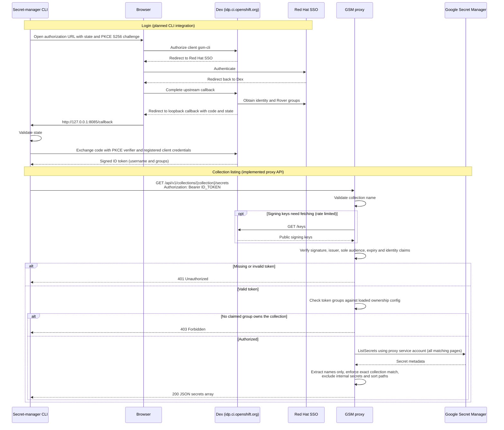

# GSM proxy

`gsm-proxy` lets authenticated CI users list secret names in Google Secret Manager (GSM)
collections owned by their Rover groups. It returns sorted `group/field` paths, never
secret values, and excludes collection indexes and updater-service-account secrets.

GSM listing is project-wide, so granting it directly to users would expose other teams'
secret names. The proxy authorizes each collection before listing with its own Google
service account. This is intended to replace the CLI's index-based listing and eventually
remove most per-group viewer IAM bindings. Writes and `get-sa` remain outside its scope.

## Authentication and authorization

Dex authenticates users through Red Hat SSO and issues signed ID tokens containing their
username and Rover groups. The proxy accepts tokens only from the `Authorization: Bearer`
header and verifies RS256 signatures, issuer `https://idp.ci.openshift.org`, sole audience
`gsm-cli`, expiration, and identity claims. Dex signing keys are cached; remote fetch
attempts are limited to once per minute.

Collection ownership comes from the release repository's
[`core-services/sync-rover-groups/_config.yaml`](https://github.com/openshift/release/blob/main/core-services/sync-rover-groups/_config.yaml),
loaded with `group.LoadConfig`. Access requires an exact group/collection match under a
claimed owner. `unclaimed` groups, Kubernetes group renames, and `groups.yaml` grant no access.

Ownership reloads directly on filesystem changes without restarting the proxy or polling.
Invalid or unreadable updates are logged and leave the
last valid snapshot active; startup requires valid configuration. A failed update can
therefore retain an old grant until a valid replacement arrives. Watcher errors are also
logged and retain the last valid snapshot; investigate them rather than assuming updates
are still being observed. Mount the ConfigMap as a directory, not with `subPath`. For local
container testing, mount the containing directory too, so atomic file replacements reach
the container.

The diagram shows the intended end-to-end CLI flow. **Production CLI login/token handling
and proxy-backed listing are not implemented in this change.** The proxy-side token
verification, authorization, and listing are implemented.



The caller's Google credentials are not sent to the proxy. Its Google service account
must have only `secretmanager.secrets.list`, with no payload-read or write permissions.
GSM metadata can contain sensitive annotations, so responses use only `Secret.Name`;
Google SDK logging is suppressed and public errors use fixed messages.

Each request to a collection endpoint produces one info-level `audit` log line with the
`action`, `collection` (only if the name is valid), `user` (the verified `preferred_username`,
only if the token was accepted), HTTP `status`, and `outcome` (`success`, `bad_request`,
`unauthenticated`, `forbidden`, `error`, or `other`). Tokens, groups, and response bodies are
never logged.

## Running locally

From the repository root, using a proxy service-account key and a release checkout:

```bash
go run ./cmd/gsm-proxy \
  --groups-ownership-file=/path/to/release/core-services/sync-rover-groups/_config.yaml \
  --gsm-project-id=openshift-ci-secrets \
  --gsm-credentials-file=/path/to/gsm-proxy-service-account.json
```

The default listener is `127.0.0.1:8080`. `GET /healthz` returns 200 without authentication.
The list endpoint returns `{"secrets":["group/field"]}` (or `{"secrets":[]}`), 400 for a
malformed collection, 401 for missing/invalid authentication, and 403 for denied access.
Upstream listing failures return a fixed 500 response, without partial results.
Use `--help` for listener and graceful-shutdown options.

## Serving HTTPS

Set `--tls-cert-file` and `--tls-key-file` together to serve HTTPS, with TLS 1.2 or newer.
For example, use `--listen-addr=0.0.0.0:8443`,
`--tls-cert-file=/etc/gsm-proxy/tls/tls.crt`, and
`--tls-key-file=/etc/gsm-proxy/tls/tls.key` alongside the GSM and ownership options.
Without these flags, only literal loopback IP listeners are allowed; there is no
plaintext listener alongside HTTPS.

Startup requires a readable, valid certificate/key pair. The controller-runtime
certificate watcher reloads replacements using filesystem events and a 10-second
polling fallback, retaining the last valid pair if a replacement cannot be loaded.
Mount the certificate Secret as a directory, not individual `subPath` files, so
Kubernetes certificate renewals reach the watcher. Certificate issuance and renewal
belong to deployment infrastructure, not the proxy.

## Before production deployment

The intended deployment is on core-ci, with an ownership ConfigMap and read-only credential
mount. Enable native HTTPS using a mounted serving certificate. Public routing must
preserve encryption to the pod, for example with a reencrypt route that validates the
backend certificate, or TLS passthrough with a certificate valid for the public hostname.
Health probes must use HTTPS when TLS is enabled.

Ownership reload does not revoke group membership in an already-issued token: the proxy
trusts that signed snapshot until expiry. Define and verify the acceptable membership-revocation
window, token lifetime/refresh behavior, and emergency revocation mechanism before production use.
Backend request deadlines and listing resource limits also remain deployment prerequisites.

Run the proxy tests with `go test ./cmd/gsm-proxy ./pkg/gsm-proxy`.
