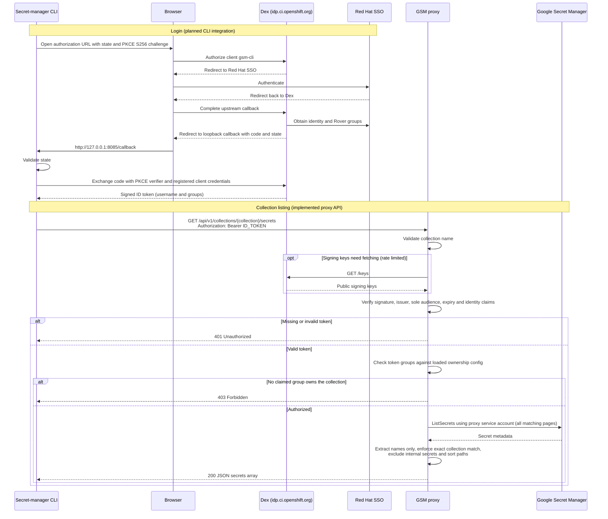

# GSM proxy

`gsm-proxy` lets the secret-manager CLI list secret names and describe secret metadata in
Google Secret Manager collections owned by the user's Rover groups.

## Access

Users authenticate through Red Hat SSO via Dex. Requests carry a Dex bearer token for the
`gsm-cli` client. Collection ownership is defined in the release repository's
[`core-services/sync-rover-groups/_config.yaml`](https://github.com/openshift/release/blob/main/core-services/sync-rover-groups/_config.yaml)
and reloaded when it changes. The proxy uses its own Google service account to access GSM
and logs requests for auditing.

## Authentication flow



## Endpoints

- `GET /api/v1/collections/{collection}/secrets`: lists the collection's secret paths.
- `GET /api/v1/collections/{collection}/secrets/{path...}`: describes a secret's metadata.
- `GET /healthz`: health check, no authentication required.

## Deployment

The [deployment manifests](https://github.com/openshift/release/blob/main/clusters/core-ci/gsm-proxy/manifests.yaml)
configure two replicas in the `ci` namespace on `core-ci`, exposed at
`https://gsm-proxy.ci.openshift.org` through a reencrypt ingress.

The pods mount the ownership ConfigMap, Google service-account credentials, and a TLS serving
certificate. The Google service account needs only `secretmanager.secrets.list` and
`secretmanager.secrets.get`; it must not be able to read secret payloads
(`secretmanager.versions.access`) or modify secrets.

## Known limitations

- Ownership reloads do not revoke group membership in already-issued tokens; a removed user keeps
  access until their token expires (at most one hour).
- GSM calls rely on the Google client's default 60-second per-call timeout; there is no proxy-side
  request deadline.

## Running locally

From the repository root, with a release checkout and Google service-account credentials:

```bash
go run ./cmd/gsm-proxy \
  --groups-ownership-file=/path/to/release/core-services/sync-rover-groups/_config.yaml \
  --gsm-project-id=openshift-ci-secrets \
  --gsm-credentials-file=/path/to/gsm-proxy-service-account.json
```

The default listener is `127.0.0.1:8080`. Non-loopback listeners require `--tls-cert-file` and
`--tls-key-file`. Use `--help` for all options.

Run tests with `go test ./cmd/gsm-proxy ./pkg/gsm-proxy`.
